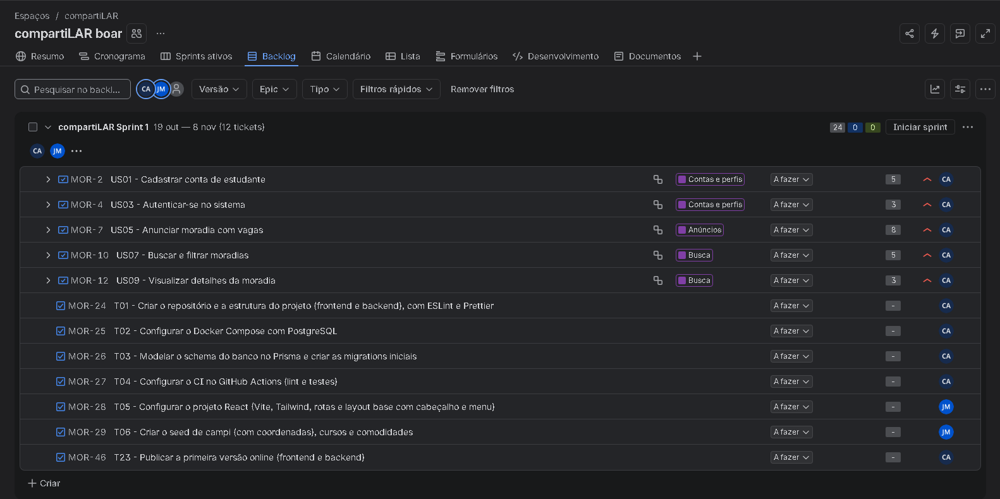
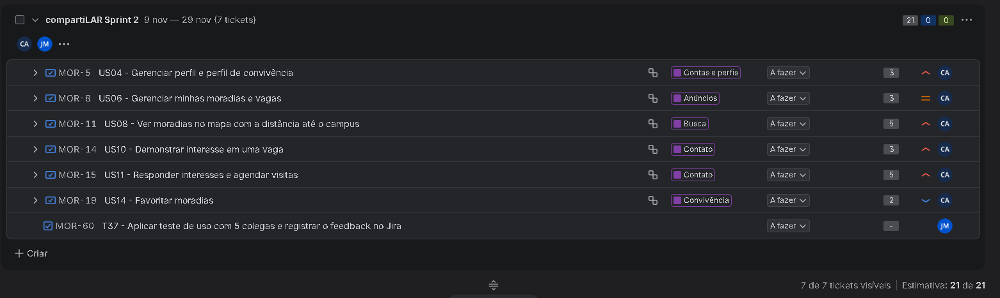
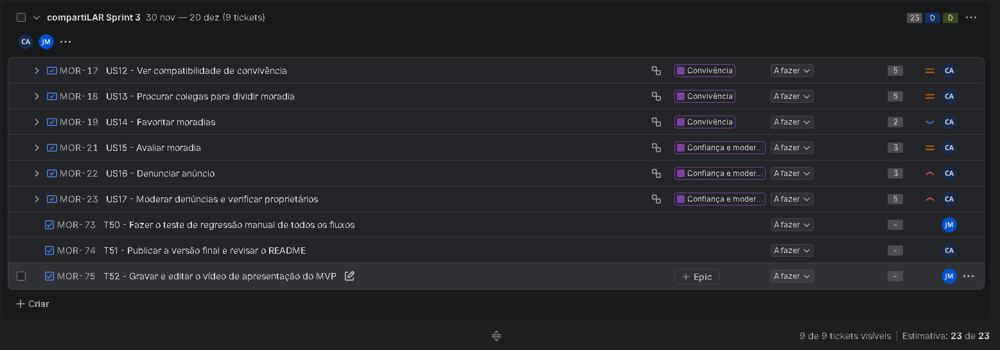
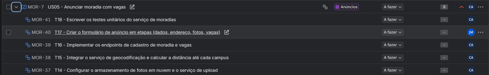
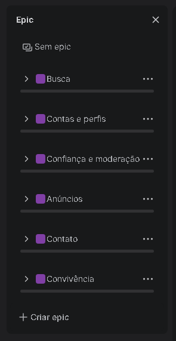
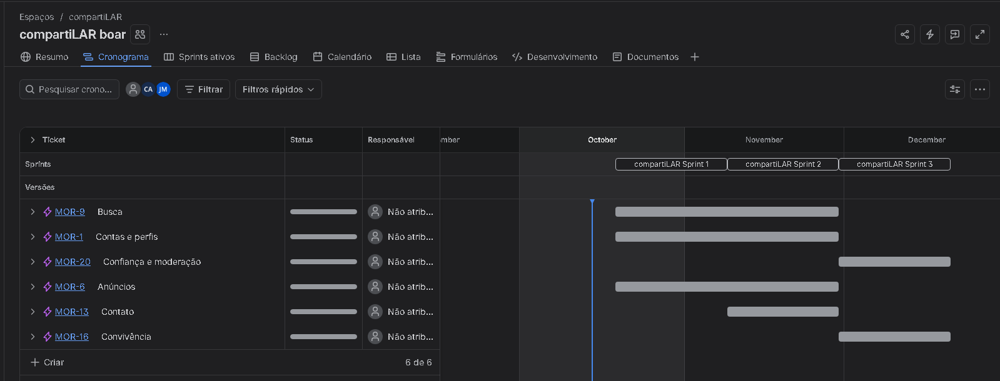

# 3. Planejamento do Desenvolvimento

## 3.1 Processo

A equipe adota o **Scrum**, adaptado para uma equipe de duas pessoas:

<!-- quadro: Adaptação do Scrum à equipe -->
| Elemento | Como será aplicado |
|---|---|
| Papéis | Cauê acumula os papéis de Product Owner e Scrum Master; os dois integrantes atuam como desenvolvedores. |
| Sprints | Três sprints de 3 semanas cada. |
| Planejamento | No início de cada sprint, a equipe seleciona as histórias e as quebra em tarefas no Jira. |
| Acompanhamento | Reunião rápida duas vezes por semana (presencial ou online) e quadro Kanban no Jira (A fazer, Em andamento, Em revisão, Concluído). |
| Revisão e retrospectiva | Ao final de cada sprint: demonstração do incremento para colegas (usuários reais) e registro do que melhorar. |
| Definição de pronto | Código revisado por meio de pull request, testes passando no CI, funcionalidade publicada no ambiente online e critérios de aceitação atendidos. |

## 3.2 Divisão de responsabilidades

<!-- quadro: Divisão de responsabilidades -->
| Integrante | Foco |
|---|---|
| **Cauê** (C) | Arquitetura, backend (API, regras de negócio, autenticação, upload de fotos, geolocalização, busca, compatibilidade, moderação), testes automatizados, CI/CD e deploy. |
| **João Pedro** (J) | Telas do frontend a partir do protótipo, dados iniciais (campi, cursos e comodidades), funcionalidades de CRUD simples (favoritos, perfil de convivência), testes manuais com usuários, documentação e vídeo de apresentação. |

## 3.3 Calendário

<!-- quadro: Calendário e metas das sprints -->
| Sprint | Período | Meta da sprint | Pontos |
|---|---|---|---|
| Sprint 1 | 19/10/2026 a 08/11/2026 | O estudante consegue se cadastrar, anunciar uma moradia e encontrá-la na busca. | 24 |
| Sprint 2 | 09/11/2026 a 29/11/2026 | O estudante vê as moradias no mapa, negocia a vaga com o anunciante até a visita e compara as favoritas. | 21 |
| Sprint 3 | 30/11/2026 a 20/12/2026 | A plataforma recebe proprietários verificados, recomenda pela convivência, é avaliada pelos usuários e é moderada. | 24 |

> As datas podem ser ajustadas conforme a data definida para a Entrega 02.

> O cálculo da compatibilidade (US12) é feito na Sprint 3. Até lá, as telas das Sprints 1 e 2 que a exibem (resultados da busca, página da moradia, interessados e comparação de favoritos) mostram o campo como indisponível; a integração nessas telas faz parte da tarefa T39.

---

## 3.4 Sprint 1: Fundação, anúncios e busca

**Backlog da sprint:** US01, US03, US05, US07, US09 (24 pontos), mais as tarefas de infraestrutura.

<!-- quadro: Tarefas da Sprint 1 -->
| ID | Tarefa | História | Resp. |
|---|---|---|---|
| T01 | Criar o repositório e a estrutura do projeto (frontend e backend), com ESLint e Prettier | Infra | C |
| T02 | Configurar o Docker Compose com PostgreSQL | Infra | C |
| T03 | Modelar o schema do banco no Prisma e criar as migrations iniciais | Infra | C |
| T04 | Configurar o CI no GitHub Actions (lint e testes) | Infra | C |
| T05 | Configurar o projeto React (Vite, Tailwind, rotas e layout base com cabeçalho e menu) | Infra | J |
| T06 | Criar o seed de campi (com coordenadas), cursos e comodidades | Infra | J |
| T07 | Implementar o endpoint de cadastro de estudante com validação do domínio `ufu.br` e hash de senha | US01 | C |
| T08 | Implementar o envio do código de confirmação por e-mail e a ativação da conta | US01 | C |
| T09 | Criar as telas de cadastro e de confirmação de e-mail | US01 | J |
| T10 | Escrever os testes unitários do serviço de cadastro | US01 | C |
| T11 | Implementar login e logout com JWT, middleware de autenticação e controle de papéis | US03 | C |
| T12 | Implementar a redefinição de senha por código enviado ao e-mail | US03 | C |
| T13 | Criar as telas de login e de redefinição de senha | US03 | J |
| T14 | Configurar o armazenamento de fotos em nuvem e o serviço de upload | US05 | C |
| T15 | Integrar o serviço de geocodificação e calcular a distância até cada campus | US05 | C |
| T16 | Implementar os endpoints de cadastro de moradia e vagas | US05 | C |
| T17 | Criar o formulário de anúncio em etapas (dados, endereço, fotos, vagas) | US05 | J |
| T18 | Escrever os testes unitários do serviço de moradias | US05 | C |
| T19 | Implementar a busca de moradias com filtros combinados, ordenação e paginação | US07 | C |
| T20 | Criar a tela de busca com painel de filtros e lista de cards | US07 | J |
| T21 | Implementar o endpoint de detalhes da moradia | US09 | C |
| T22 | Criar a página de detalhes da moradia | US09 | J |
| T23 | Publicar a primeira versão online (frontend e backend) | Infra | C |

## 3.5 Sprint 2: Mapa, contato e favoritos

**Backlog da sprint:** US04, US06, US08, US10, US11, US14 (21 pontos).

<!-- quadro: Tarefas da Sprint 2 -->
| ID | Tarefa | História | Resp. |
|---|---|---|---|
| T26 | Implementar os endpoints de perfil e de perfil de convivência | US04 | J |
| T27 | Criar a tela "Meu perfil" com o questionário de convivência | US04 | J |
| T28 | Implementar edição, pausa e remoção de moradias, gestão de vagas e vínculo de moradores | US06 | C |
| T29 | Criar a tela "Minhas moradias" | US06 | J |
| T30 | Implementar o endpoint do mapa com localização aproximada (deslocamento aleatório fixo) | US08 | C |
| T31 | Criar a visualização em mapa com os campi e as moradias | US08 | J |
| T32 | Implementar o registro de interesse e a notificação por e-mail ao anunciante | US10 | C |
| T33 | Criar o formulário "Tenho interesse" e a tela "Meus interesses" | US10 | J |
| T34 | Implementar aceite e recusa de interesses, liberação de contato e agendamento de visita | US11 | C |
| T35 | Escrever os testes unitários do fluxo de interesse e visita | US11 | C |
| T36 | Criar a tela de interessados por vaga e o agendamento de visita | US11 | J |
| T42 | Implementar os endpoints de adicionar, remover e listar favoritos | US14 | J |
| T43 | Criar o botão de favoritar, a tela "Favoritos" e a comparação lado a lado | US14 | J |
| T37 | Aplicar teste de uso com 5 colegas e registrar o feedback no Jira | Validação | J |

## 3.6 Sprint 3: Proprietários, convivência e moderação

**Backlog da sprint:** US02, US12, US13, US15, US16, US17 (24 pontos).

<!-- quadro: Tarefas da Sprint 3 -->
| ID | Tarefa | História | Resp. |
|---|---|---|---|
| T24 | Implementar o cadastro de proprietário com status "aguardando verificação" | US02 | C |
| T25 | Criar a opção de cadastro como proprietário na tela de cadastro | US02 | J |
| T38 | Implementar o algoritmo de compatibilidade de convivência, com testes unitários | US12 | C |
| T39 | Exibir a compatibilidade na página da moradia (com pontos em comum e de atenção), nos resultados da busca, nos interessados e na comparação de favoritos | US12 | J |
| T40 | Implementar os endpoints de procura de colegas e de convites | US13 | C |
| T41 | Criar o mural "Procuro colega" e o formulário de convite | US13 | J |
| T44 | Implementar avaliações com a regra de elegibilidade e a resposta do anunciante | US15 | C |
| T45 | Criar o formulário de avaliação e a lista de avaliações | US15 | J |
| T46 | Implementar o registro de denúncias e a ocultação automática com 3 denúncias | US16 | C |
| T47 | Criar o formulário de denúncia | US16 | J |
| T48 | Implementar as filas de moderação, as decisões, a suspensão e as notificações | US17 | C |
| T49 | Criar o painel de moderação (denúncias e verificação de proprietários) | US17 | J |
| T50 | Fazer o teste de regressão manual de todos os fluxos | Qualidade | J |
| T51 | Publicar a versão final e revisar o README | Infra | C |
| T52 | Gravar e editar o vídeo de apresentação do MVP | Entrega | J |

---

## 3.7 Ferramenta de gestão: Jira

O planejamento acima está cadastrado no Jira (projeto **compartiLAR**, chave **MOR**), com os 6 épicos, as 17 histórias com pontos e prioridade, as 52 tarefas com responsável e as três sprints com suas datas.

- **Link:** https://projetomorada.atlassian.net
- **Usuário e senha:** informados no documento entregue ao professor.

### Prints de tela

<!-- fonte: Captura de tela do Jira Software feita pelos autores (2026). -->

<!-- fonte: Captura de tela do Jira Software feita pelos autores (2026). -->

<!-- fonte: Captura de tela do Jira Software feita pelos autores (2026). -->

<!-- fonte: Captura de tela do Jira Software feita pelos autores (2026). -->

<!-- fonte: Captura de tela do Jira Software feita pelos autores (2026). -->

<!-- fonte: Captura de tela do Jira Software feita pelos autores (2026). -->

