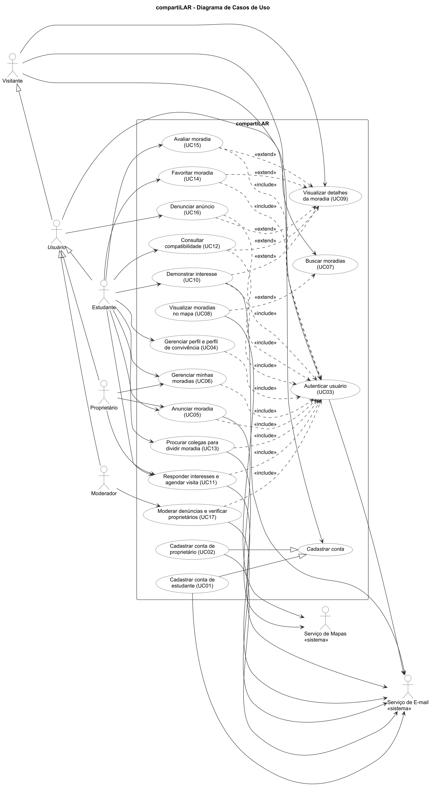

# 4. Casos de Uso

Cada caso de uso detalha uma história de usuário do backlog (UC01 corresponde a US01, UC02 a US02, e assim por diante). As descrições seguem o modelo do Anexo I:

- O **fluxo normal** descreve o cenário em que tudo dá certo.
- As **extensões** descrevem alternativas e situações de erro. A numeração indica o passo do fluxo normal a que se referem (ex.: `2a` estende o passo 2). O prefixo `*` indica uma extensão que pode ocorrer em qualquer passo.
- A inclusão de outro caso de uso aparece com o nome <ins>sublinhado</ins>: todos os passos do caso incluído são executados antes de prosseguir.

## 4.1 Atores

| Ator | Tipo | Descrição |
|---|---|---|
| **Visitante** | Principal | Pessoa não autenticada. Pode criar uma conta, buscar moradias e ver seus detalhes. |
| **Usuário** | Principal (abstrato) | Qualquer pessoa autenticada. Herda tudo o que o Visitante pode fazer. Especializa-se em Estudante, Proprietário e Moderador. |
| **Estudante** | Principal | Usuário com e-mail da UFU. Procura moradia e também pode anunciar vagas onde mora. |
| **Proprietário** | Principal | Usuário verificado pela moderação que anuncia imóveis próprios. |
| **Moderador** | Principal | Usuário da equipe responsável por denúncias e pela verificação de proprietários. |
| **Serviço de E-mail** | Secundário | Sistema externo que envia códigos de confirmação e notificações. |
| **Serviço de Mapas** | Secundário | Sistema externo que converte endereços em coordenadas e exibe mapas. |

## 4.2 Diagrama de casos de uso

Fonte do diagrama: [casos-de-uso.puml](../diagramas/casos-de-uso.puml).

**Relacionamentos representados:**

| Tipo | Relacionamento |
|---|---|
| Generalização de atores | Usuário → Visitante; Estudante, Proprietário e Moderador → Usuário |
| Generalização de casos de uso | "Cadastrar conta de estudante" (UC01) e "Cadastrar conta de proprietário" (UC02) especializam "Cadastrar conta" |
| Inclusão (`<<include>>`) | UC04, UC05, UC06, UC10, UC11, UC12, UC13, UC14, UC15, UC16 e UC17 incluem "Autenticar usuário" (UC03) |
| Extensão (`<<extend>>`) | "Visualizar moradias no mapa" (UC08) estende "Buscar moradias" (UC07) |
| Extensão (`<<extend>>`) | "Demonstrar interesse" (UC10), "Consultar compatibilidade" (UC12), "Favoritar moradia" (UC14), "Avaliar moradia" (UC15) e "Denunciar anúncio" (UC16) estendem "Visualizar detalhes da moradia" (UC09) |

---

## 4.3 Descrições

### Cadastrar conta de estudante (UC01)

**Ator principal:** Visitante
**Ator secundário:** Serviço de E-mail
**Propósito:** criar uma conta de estudante validada pelo e-mail institucional.
**Pré-condição:** o visitante não possui conta.
**Generalização:** especializa o caso de uso abstrato "Cadastrar conta".

**Fluxo normal:**
1. O visitante informa nome, e-mail institucional, senha, curso e telefone.
2. O sistema valida os dados informados.
3. O sistema registra a conta como pendente de confirmação.
4. O sistema envia um código de confirmação para o e-mail informado.
5. O visitante informa o código recebido.
6. O sistema ativa a conta com o papel de Estudante.
7. O sistema inicia a sessão e sugere o preenchimento do perfil de convivência (UC04).

**Extensões:**
- 2a. O e-mail não pertence ao domínio `ufu.br`: o sistema informa que contas de estudante exigem e-mail institucional e oferece o cadastro como proprietário (UC02).
- 2b. O e-mail já está cadastrado: o sistema informa o fato e oferece a redefinição de senha (UC03, extensão 2b).
- 2c. A senha não atende à política (mínimo de 8 caracteres, com letras e números): o sistema solicita uma nova senha.
- 5a. O código está incorreto: o sistema solicita o código novamente. Após 5 tentativas, o código é invalidado e um novo é enviado.
- 5b. O código expirou (validade de 30 minutos) ou o visitante solicita o reenvio: o sistema envia um novo código.

**Pós-condição:** existe uma conta ativa de estudante associada ao e-mail informado.
**Casos de uso relacionados:** UC02, UC03, UC04.

---

### Cadastrar conta de proprietário (UC02)

**Ator principal:** Visitante
**Ator secundário:** Serviço de E-mail
**Propósito:** criar uma conta para quem aluga imóveis a estudantes.
**Pré-condição:** o visitante não possui conta.
**Generalização:** especializa o caso de uso abstrato "Cadastrar conta".

**Fluxo normal:**
1. O visitante informa nome, e-mail, senha, telefone e CPF.
2. O sistema valida os dados informados.
3. O sistema registra a conta como pendente de confirmação.
4. O sistema envia um código de confirmação para o e-mail informado.
5. O visitante informa o código recebido.
6. O sistema ativa a conta com o papel de Proprietário e o status "aguardando verificação".
7. O sistema informa que os anúncios ficarão visíveis após a verificação pela moderação.

**Extensões:**
- 2a. O CPF é inválido: o sistema solicita um novo CPF.
- 2b. O e-mail ou o CPF já está cadastrado: o sistema informa o fato e oferece a redefinição de senha (UC03, extensão 2b).
- 5a. O código está incorreto ou expirou: o sistema age como em UC01, extensões 5a e 5b.

**Pós-condição:** existe uma conta de proprietário aguardando verificação na fila de moderação (UC17).
**Casos de uso relacionados:** UC01, UC03, UC17.

---

### Autenticar usuário (UC03)

**Ator principal:** Usuário
**Ator secundário:** Serviço de E-mail
**Propósito:** identificar o usuário e iniciar uma sessão no sistema.
**Pré-condição:** o usuário possui uma conta.

**Fluxo normal:**
1. O usuário informa e-mail e senha.
2. O sistema verifica as credenciais.
3. O sistema verifica se a conta está ativa.
4. O sistema inicia a sessão com as permissões do papel do usuário.

**Extensões:**
- 2a. As credenciais estão incorretas: o sistema informa que e-mail ou senha são inválidos, sem indicar qual. Após 5 tentativas em 15 minutos, o sistema bloqueia novas tentativas por 15 minutos.
- 2b. O usuário esqueceu a senha: o usuário informa o e-mail; o sistema envia um código de redefinição; o usuário informa o código e a nova senha; o sistema altera a senha e retorna ao passo 1.
- 3a. A conta está pendente de confirmação: o sistema informa e oferece o reenvio do código.
- 3b. A conta está suspensa: o sistema informa o motivo e a data de término da suspensão.
- *a. A qualquer momento após o passo 4, o usuário solicita o encerramento da sessão: o sistema encerra a sessão.

**Pós-condição:** o usuário tem uma sessão ativa.
**Casos de uso relacionados:** UC01, UC02; incluído por UC04, UC05, UC06, UC10, UC11, UC12, UC13, UC14, UC15, UC16 e UC17.

---

### Gerenciar perfil e perfil de convivência (UC04)

**Ator principal:** Estudante
**Propósito:** manter atualizados os dados pessoais e os hábitos de convivência.
**Pré-condição:** nenhuma.

**Fluxo normal:**
1. Incluir <ins>Autenticar usuário (UC03)</ins>.
2. O estudante solicita a edição do perfil.
3. O sistema apresenta os dados pessoais e o perfil de convivência atuais.
4. O estudante altera nome, foto, curso, telefone ou apresentação.
5. O estudante informa os hábitos de convivência: horário de sono, organização e limpeza, frequência de festas e visitas, visitas que dormem, se fuma, se tem pets, se aceita pets, onde estuda, importância de silêncio, divisão de tarefas e tempo de permanência.
6. O sistema valida os dados.
7. O sistema salva as alterações.

**Extensões:**
- 4a. O estudante tenta alterar o e-mail: o sistema informa que o e-mail não pode ser alterado.
- 5a. O estudante não deseja informar os hábitos agora: o sistema salva apenas os dados pessoais e avisa que a compatibilidade não será calculada.
- 6a. A foto está em formato não suportado ou tem mais de 5 MB: o sistema solicita outra foto.

**Pós-condição:** o perfil do estudante está atualizado.
**Casos de uso relacionados:** UC03, UC12, UC13.

---

### Anunciar moradia (UC05)

**Ator principal:** Estudante ou Proprietário
**Ator secundário:** Serviço de Mapas
**Propósito:** divulgar uma moradia com vagas disponíveis.
**Pré-condição:** nenhuma.

**Fluxo normal:**
1. Incluir <ins>Autenticar usuário (UC03)</ins>.
2. O anunciante informa tipo, título, descrição, público, comodidades, regras, número de moradores, divisão das despesas e mobília incluída.
3. O anunciante informa o endereço completo.
4. O sistema obtém as coordenadas do endereço junto ao Serviço de Mapas.
5. O sistema calcula a distância da moradia até cada campus.
6. O anunciante anexa as fotos e indica o cômodo de cada uma.
7. O anunciante informa as vagas: tipo de quarto, valor do aluguel, estimativa de contas, condomínio e data de disponibilidade.
8. O sistema valida os dados e registra a moradia como ativa.
9. O sistema apresenta a moradia publicada.

**Extensões:**
- 4a. O endereço não é encontrado: o sistema solicita que o anunciante corrija o endereço ou indique a localização manualmente no mapa.
- 6a. Há mais de 10 fotos ou alguma está em formato inválido: o sistema solicita a correção.
- 7a. O valor do aluguel é menor ou igual a zero: o sistema solicita um novo valor.
- 8a. O anunciante é um proprietário ainda não verificado: o sistema registra a moradia como "aguardando verificação" e informa que ela ficará visível após a aprovação do cadastro.

**Pós-condição:** a moradia e suas vagas estão registradas e, se o anunciante estiver verificado, visíveis na busca.
**Casos de uso relacionados:** UC03, UC06, UC07.

---

### Gerenciar minhas moradias (UC06)

**Ator principal:** Estudante ou Proprietário
**Propósito:** manter as moradias, as vagas e os moradores atualizados.
**Pré-condição:** o anunciante possui ao menos uma moradia.

**Fluxo normal:**
1. Incluir <ins>Autenticar usuário (UC03)</ins>.
2. O anunciante solicita a lista das próprias moradias.
3. O sistema apresenta as moradias com o status, as vagas disponíveis e o número de interessados.
4. O anunciante seleciona uma moradia e a ação desejada: editar, pausar, remover, gerenciar vagas ou gerenciar moradores.
5. O sistema aplica a alteração.
6. O sistema apresenta a lista atualizada.

**Extensões:**
- 4a. A ação é editar: o anunciante altera os dados, com as mesmas regras de UC05.
- 4b. A ação é gerenciar vagas: o anunciante adiciona uma vaga ou marca uma vaga como ocupada.
- 4c. A ação é gerenciar moradores: o anunciante informa o e-mail de um estudante cadastrado; o sistema envia o convite de vínculo, e o vínculo só passa a valer após a confirmação do estudante.
- 4d. A ação é remover: o sistema solicita confirmação e encerra os interesses pendentes, notificando os interessados.
- 5a. Todas as vagas da moradia ficaram ocupadas: o sistema retira a moradia da busca.

**Pós-condição:** a moradia está atualizada.
**Casos de uso relacionados:** UC03, UC05, UC11, UC12.

---

### Buscar moradias (UC07)

**Ator principal:** Visitante (e, por herança, todos os usuários)
**Propósito:** encontrar moradias que atendam às necessidades do ator.
**Pré-condição:** nenhuma.

**Fluxo normal:**
1. O ator escolhe o campus de referência.
2. O ator seleciona os filtros: tipo de moradia, faixa de valor, distância máxima, público, tipo de quarto e comodidades.
3. O ator escolhe a ordenação: menor valor, menor distância ou mais recentes.
4. O sistema apresenta a primeira página de moradias ativas com vagas que atendem aos critérios, com foto, indicação de imóvel inteiro ou vaga compartilhada, bairro, valor total, distância e tempo a pé até o campus.

**Extensões:**
- 1a. O ator não escolhe um campus: o sistema ordena e filtra sem considerar a distância.
- 4a. Nenhuma moradia atende aos critérios: o sistema informa e sugere ampliar os filtros.
- 4b. O ator solicita a próxima página: o sistema apresenta a página seguinte.
- 4c. Ponto de extensão: <ins>Visualizar moradias no mapa (UC08)</ins>.

**Pós-condição:** nenhuma alteração nos dados.
**Casos de uso relacionados:** UC08, UC09.

---

### Visualizar moradias no mapa (UC08)

**Ator principal:** Visitante (e, por herança, todos os usuários)
**Ator secundário:** Serviço de Mapas
**Propósito:** entender a localização das moradias em relação aos campi.
**Pré-condição:** o ator realizou uma busca (UC07).

**Fluxo normal:**
1. O ator solicita a visualização em mapa.
2. O sistema apresenta o mapa com os campi de Uberlândia.
3. O sistema marca a região aproximada de cada moradia encontrada.
4. O ator seleciona uma moradia no mapa.
5. O sistema apresenta o resumo da moradia, com valor e distância até o campus de referência.

**Extensões:**
- 3a. O ator tem um interesse aceito em uma das moradias: o sistema marca a localização exata dessa moradia.
- 3b. O Serviço de Mapas está indisponível: o sistema informa e mantém os resultados em lista.
- 4a. O ator altera os filtros: o sistema atualiza as marcações do mapa.

**Pós-condição:** nenhuma alteração nos dados.
**Casos de uso relacionados:** UC07, UC09.

---

### Visualizar detalhes da moradia (UC09)

**Ator principal:** Visitante (e, por herança, todos os usuários)
**Propósito:** conhecer todas as informações de uma moradia antes de demonstrar interesse.
**Pré-condição:** a moradia existe.

**Fluxo normal:**
1. O ator seleciona uma moradia.
2. O sistema apresenta fotos, descrição, tipo, bairro, região no mapa, distâncias até os campi, público, comodidades, regras, moradores atuais (nome, curso e período), divisão das despesas, vagas com valores e datas, nota média das avaliações e dados públicos do anunciante.

**Extensões:**
- 1a. A moradia foi removida, pausada ou está oculta pela moderação: o sistema informa que a moradia está indisponível.
- 2a. O anunciante é um proprietário verificado: o sistema exibe o selo "proprietário verificado".
- 2b. Ponto de extensão: <ins>Demonstrar interesse (UC10)</ins>.
- 2c. Ponto de extensão: <ins>Consultar compatibilidade (UC12)</ins>.
- 2d. Ponto de extensão: <ins>Favoritar moradia (UC14)</ins>.
- 2e. Ponto de extensão: <ins>Avaliar moradia (UC15)</ins>.
- 2f. Ponto de extensão: <ins>Denunciar anúncio (UC16)</ins>.

**Pós-condição:** nenhuma alteração nos dados.
**Casos de uso relacionados:** UC07, UC08, UC10, UC12, UC14, UC15, UC16.

---

### Demonstrar interesse (UC10)

**Ator principal:** Estudante
**Ator secundário:** Serviço de E-mail
**Propósito:** iniciar o contato com o anunciante para ocupar uma vaga.
**Pré-condição:** o ator está visualizando uma moradia com vagas disponíveis (UC09).

**Fluxo normal:**
1. Incluir <ins>Autenticar usuário (UC03)</ins>.
2. O estudante escolhe a vaga.
3. O estudante escreve uma mensagem de apresentação, ciente de que ela será enviada ao anunciante e de que o interesse ficará pendente até a resposta.
4. O sistema registra o interesse como pendente.
5. O sistema envia um e-mail ao anunciante informando o novo interessado.
6. O sistema confirma o envio ao estudante.

**Extensões:**
- 1a. O usuário autenticado não é um estudante: o sistema informa que apenas estudantes podem demonstrar interesse, e o caso de uso é encerrado.
- 2a. O estudante é morador ou anunciante da moradia: o sistema informa que não é possível demonstrar interesse, e o caso de uso é encerrado.
- 2b. O estudante já tem um interesse ativo nessa vaga: o sistema apresenta o interesse existente e o seu status.
- 4a. A vaga foi ocupada nesse meio-tempo: o sistema informa que a vaga não está mais disponível.
- 5a. O envio do e-mail falha: o sistema mantém o interesse registrado e tenta o envio novamente mais tarde.

**Pós-condição:** o interesse está registrado como pendente e o anunciante foi notificado.
**Casos de uso relacionados:** UC03, UC09, UC11.

---

### Responder interesses e agendar visita (UC11)

**Ator principal:** Estudante ou Proprietário (no papel de anunciante)
**Ator secundário:** Serviço de E-mail
**Propósito:** selecionar candidatos à vaga e combinar uma visita.
**Pré-condição:** o anunciante recebeu ao menos um interesse.

**Fluxo normal:**
1. Incluir <ins>Autenticar usuário (UC03)</ins>.
2. O anunciante solicita os interesses recebidos.
3. O sistema apresenta os interessados por vaga, com a apresentação, o curso, o período, o selo de estudante verificado e a compatibilidade de cada um.
4. O anunciante aceita um interesse.
5. O sistema libera ao estudante o endereço exato e o telefone do anunciante, e ao anunciante o telefone do estudante.
6. O anunciante propõe data e horário para a visita.
7. O sistema envia ao estudante um e-mail com o aceite e a proposta de visita.
8. O estudante confirma a visita.
9. O sistema registra a visita como confirmada.

**Extensões:**
- 4a. O anunciante recusa o interesse: o sistema registra a recusa, notifica o estudante, e o caso de uso é encerrado para esse interesse.
- 6a. O anunciante prefere combinar a visita diretamente: o caso de uso é encerrado após o passo 5.
- 8a. O estudante recusa o horário e sugere outro: o sistema notifica o anunciante, que confirma ou propõe um novo horário.
- 8b. O estudante desiste da vaga: o sistema registra o interesse como cancelado e notifica o anunciante.

**Pós-condição:** o interesse está aceito ou recusado e, quando combinada, a visita está registrada.
**Casos de uso relacionados:** UC03, UC06, UC10, UC12, UC15.

---

### Consultar compatibilidade (UC12)

**Ator principal:** Estudante
**Propósito:** estimar se a convivência com os moradores atuais tende a dar certo.
**Pré-condição:** o ator está visualizando uma moradia (UC09).

**Fluxo normal:**
1. Incluir <ins>Autenticar usuário (UC03)</ins>.
2. O estudante solicita a compatibilidade com os moradores.
3. O sistema compara o perfil de convivência do estudante com o de cada morador vinculado.
4. O sistema calcula o percentual médio de compatibilidade.
5. O sistema apresenta o percentual, os pontos em comum e os pontos de atenção, sem revelar os hábitos individuais dos moradores.

**Extensões:**
- 3a. O estudante não preencheu o perfil de convivência: o sistema oferece o preenchimento (UC04) e retorna ao passo 3 em seguida.
- 3b. Nenhum morador vinculado tem perfil de convivência: o sistema informa que a compatibilidade não está disponível para essa moradia.

**Pós-condição:** nenhuma alteração nos dados.
**Casos de uso relacionados:** UC03, UC04, UC06, UC09, UC13.

---

### Procurar colegas para dividir moradia (UC13)

**Ator principal:** Estudante
**Ator secundário:** Serviço de E-mail
**Propósito:** encontrar outros estudantes para alugar um imóvel em conjunto.
**Pré-condição:** nenhuma.

**Fluxo normal:**
1. Incluir <ins>Autenticar usuário (UC03)</ins>.
2. O estudante publica sua procura com orçamento máximo, campus de referência, tipo de moradia desejada, data prevista de mudança e descrição.
3. O sistema apresenta as procuras ativas de outros estudantes, ordenadas pela compatibilidade de convivência.
4. O estudante seleciona uma procura e envia um convite com mensagem.
5. O sistema envia um e-mail ao destinatário do convite.
6. O destinatário aceita o convite.
7. O sistema libera o telefone de ambos.

**Extensões:**
- 2a. O estudante já tem uma procura ativa: o sistema apresenta a procura existente para edição.
- 3a. Não há outras procuras ativas: o sistema informa e avisa que a procura do estudante ficará visível para os próximos.
- 6a. O destinatário recusa o convite: o sistema notifica o remetente.
- *a. O estudante encerra a própria procura: o sistema a retira do mural.

**Pós-condição:** a procura está publicada e, quando aceito, o convite liberou o contato entre os estudantes.
**Casos de uso relacionados:** UC03, UC04, UC12.

---

### Favoritar moradia (UC14)

**Ator principal:** Estudante
**Propósito:** guardar moradias para comparar e consultar depois.
**Pré-condição:** o ator está visualizando uma moradia (UC09).

**Fluxo normal:**
1. Incluir <ins>Autenticar usuário (UC03)</ins>.
2. O estudante solicita a inclusão da moradia nos favoritos.
3. O sistema registra o favorito.
4. O sistema indica que a moradia está entre os favoritos.

**Extensões:**
- 2a. A moradia já está entre os favoritos: o sistema remove o favorito.
- *a. O estudante solicita a lista de favoritos: o sistema apresenta as moradias favoritas, indicando as que não têm mais vagas.

**Pós-condição:** a lista de favoritos do estudante está atualizada.
**Casos de uso relacionados:** UC03, UC09.

---

### Avaliar moradia (UC15)

**Ator principal:** Estudante
**Propósito:** compartilhar a experiência com a moradia para orientar outros estudantes.
**Pré-condição:** o ator está visualizando uma moradia (UC09).

**Fluxo normal:**
1. Incluir <ins>Autenticar usuário (UC03)</ins>.
2. O sistema verifica que o estudante teve um interesse aceito ou foi morador da moradia.
3. O estudante atribui notas de 1 a 5 para custo-benefício, localização, conservação e convivência.
4. O estudante escreve um comentário.
5. O sistema registra a avaliação e recalcula a nota média da moradia.
6. O sistema notifica o anunciante sobre a nova avaliação.

**Extensões:**
- 2a. O estudante não teve vínculo com a moradia: o sistema informa que apenas quem visitou ou morou pode avaliar, e o caso de uso é encerrado.
- 2b. O estudante já avaliou a moradia: o sistema apresenta a avaliação anterior para edição.
- 4a. O comentário tem mais de 1.000 caracteres: o sistema solicita um texto menor.
- *a. O anunciante responde à avaliação: o sistema publica a resposta junto à avaliação.

**Pós-condição:** a avaliação está registrada e a nota média está atualizada.
**Casos de uso relacionados:** UC03, UC09, UC11.

---

### Denunciar anúncio (UC16)

**Ator principal:** Usuário
**Propósito:** sinalizar à moderação um anúncio suspeito ou irregular.
**Pré-condição:** o ator está visualizando uma moradia (UC09).

**Fluxo normal:**
1. Incluir <ins>Autenticar usuário (UC03)</ins>.
2. O usuário informa o motivo: golpe ou pedido de pagamento antecipado, anúncio falso, discriminação, conteúdo inadequado ou outro.
3. O usuário descreve o problema.
4. O sistema registra a denúncia como pendente.
5. O sistema confirma o recebimento da denúncia.

**Extensões:**
- 2a. O usuário já denunciou essa moradia: o sistema informa que a denúncia já está registrada, e o caso de uso é encerrado.
- 4a. A moradia atingiu 3 denúncias pendentes: o sistema oculta a moradia até a análise da moderação.

**Pós-condição:** a denúncia está registrada e aguarda análise.
**Casos de uso relacionados:** UC03, UC09, UC17.

---

### Moderar denúncias e verificar proprietários (UC17)

**Ator principal:** Moderador
**Ator secundário:** Serviço de E-mail
**Propósito:** manter a plataforma segura, removendo anúncios irregulares e verificando proprietários.
**Pré-condição:** o usuário possui o papel de Moderador.

**Fluxo normal:**
1. Incluir <ins>Autenticar usuário (UC03)</ins>.
2. O moderador solicita a fila de denúncias pendentes.
3. O sistema apresenta as moradias denunciadas, ordenadas pela quantidade de denúncias.
4. O moderador seleciona uma moradia.
5. O sistema apresenta a moradia, as denúncias e o histórico do anunciante.
6. O moderador registra a decisão e a justificativa.
7. O sistema aplica a decisão a todas as denúncias pendentes da moradia.
8. O sistema envia ao anunciante um e-mail com a decisão.

**Extensões:**
- 2a. O moderador solicita a fila de proprietários aguardando verificação: o sistema apresenta os cadastros; o moderador aprova ou recusa cada um, informando o motivo; o sistema torna visíveis as moradias dos aprovados e notifica o proprietário por e-mail.
- 3a. Não há denúncias pendentes: o sistema informa que a fila está vazia.
- 6a. A decisão é "procedente": o sistema remove a moradia e encerra os interesses pendentes.
- 6b. A decisão é "improcedente": o sistema torna a moradia visível novamente.
- 6c. O moderador decide suspender o anunciante: o moderador informa o prazo; o sistema suspende a conta e oculta todas as moradias do anunciante.

**Pós-condição:** as denúncias estão resolvidas ou os cadastros de proprietários estão verificados, e os afetados foram notificados.
**Casos de uso relacionados:** UC02, UC03, UC16.
