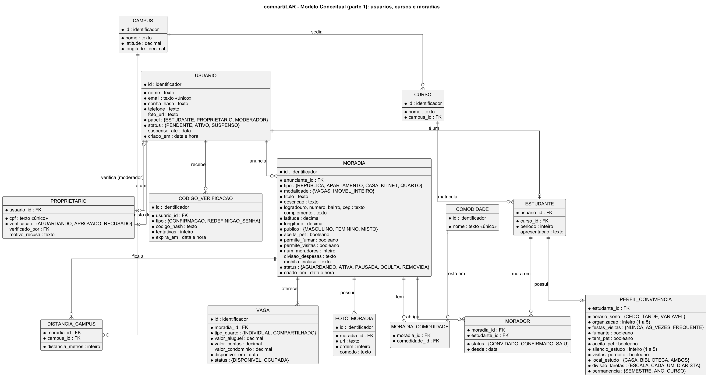
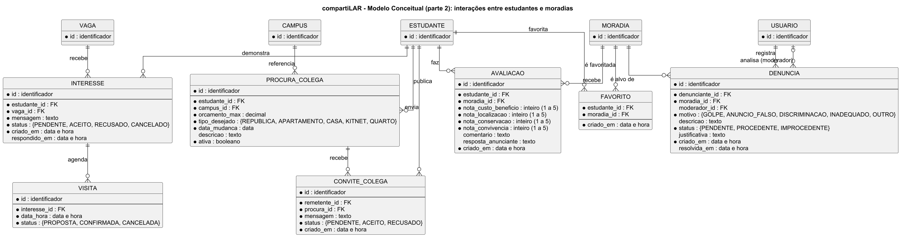

# 5. Modelo Conceitual

## 5.1 Diagrama entidade-relacionamento

O diagrama usa a notação "pé de galinha" (crow's foot) para as cardinalidades:

- `||` exatamente um;
- `|o` zero ou um;
- `o{` zero ou muitos;
- `|{` um ou muitos.

Para facilitar a leitura, o diagrama está dividido em duas partes. Na parte 2, as entidades em cinza (USUARIO, ESTUDANTE, MORADIA, VAGA e CAMPUS) são as detalhadas na parte 1 e aparecem apenas com o identificador.

Fonte do diagrama: [modelo-conceitual.puml](../diagramas/modelo-conceitual.puml) (modelo completo) e as duas partes em [docs/diagramas](../diagramas/).

## 5.2 Dicionário de entidades

<!-- quadro: Dicionário de entidades -->
| Entidade | Descrição |
|---|---|
| **USUARIO** | Pessoa cadastrada. O atributo `papel` indica se é Estudante, Proprietário ou Moderador; o atributo `status` controla confirmação e suspensão. |
| **ESTUDANTE** | Especialização de USUARIO para estudantes da UFU, com curso, período e apresentação. |
| **PROPRIETARIO** | Especialização de USUARIO para quem aluga imóveis, com CPF e situação da verificação feita pela moderação. |
| **PERFIL_CONVIVENCIA** | Hábitos do estudante usados no cálculo de compatibilidade: sono, organização, festas e visitas, visitas que dormem, fumo, pets, local e silêncio para estudar, divisão de tarefas e tempo de permanência. |
| **CODIGO_VERIFICACAO** | Código temporário enviado por e-mail para confirmar a conta ou redefinir a senha. |
| **CAMPUS** | Campus da UFU com suas coordenadas (Santa Mônica, Umuarama, Educação Física e Glória). |
| **CURSO** | Curso de graduação ou pós-graduação, vinculado ao campus onde é oferecido. |
| **MORADIA** | Imóvel anunciado (república, apartamento, casa, kitnet ou quarto), com a modalidade (vagas em moradia compartilhada ou imóvel inteiro), endereço, coordenadas, público, regras, número de moradores, divisão das despesas, mobília incluída e status. |
| **DISTANCIA_CAMPUS** | Distância calculada entre uma moradia e cada campus, usada nos filtros e na ordenação. |
| **COMODIDADE** e **MORADIA_COMODIDADE** | Catálogo de comodidades (internet, garagem, lavanderia, mobiliada etc.) e sua associação com as moradias. |
| **FOTO_MORADIA** | Foto de uma moradia, com a legenda do cômodo. Cada moradia tem de 1 a 10 fotos. |
| **VAGA** | Vaga oferecida em uma moradia, com tipo de quarto, aluguel, estimativa de contas, condomínio e data de disponibilidade. |
| **MORADOR** | Vínculo, confirmado pelo estudante, entre um estudante e a moradia onde ele mora. Base do cálculo de compatibilidade. |
| **INTERESSE** | Manifestação de interesse de um estudante em uma vaga, com a mensagem e a resposta do anunciante. |
| **VISITA** | Visita agendada a partir de um interesse aceito. |
| **PROCURA_COLEGA** | Publicação de um estudante que procura colegas para dividir um aluguel. |
| **CONVITE_COLEGA** | Convite enviado por um estudante a outro a partir de uma procura. |
| **AVALIACAO** | Avaliação de uma moradia por quem visitou a moradia ou morou nela, com notas por critério e a resposta do anunciante. |
| **FAVORITO** | Moradias salvas por um estudante. |
| **DENUNCIA** | Denúncia de uma moradia, com o motivo, a decisão do moderador e a justificativa. |

## 5.3 Relacionamentos

<!-- quadro: Relacionamentos do modelo conceitual -->
| Relacionamento | Cardinalidade | Descrição |
|---|---|---|
| USUARIO – ESTUDANTE / PROPRIETARIO | 1 : 0..1 | Especialização: cada usuário é, no máximo, um estudante ou um proprietário. |
| USUARIO (moderador) – PROPRIETARIO | 0..1 : N | Um moderador verifica vários proprietários. |
| USUARIO – CODIGO_VERIFICACAO | 1 : N | Um usuário pode receber vários códigos ao longo do tempo. |
| ESTUDANTE – PERFIL_CONVIVENCIA | 1 : 0..1 | O perfil de convivência é opcional. |
| CAMPUS – CURSO | 1 : N | Cada curso é oferecido em um campus. |
| CURSO – ESTUDANTE | 1 : N | Cada estudante está matriculado em um curso. |
| USUARIO – MORADIA | 1 : N | Um usuário (estudante ou proprietário) anuncia várias moradias. |
| MORADIA – FOTO_MORADIA | 1 : N (mín. 1) | Uma moradia possui ao menos uma foto. |
| MORADIA – VAGA | 1 : N (mín. 1) | Uma moradia oferece ao menos uma vaga. |
| MORADIA – COMODIDADE | N : N | Resolvido pela entidade associativa MORADIA_COMODIDADE. |
| MORADIA – CAMPUS | N : N | Resolvido por DISTANCIA_CAMPUS, que guarda a distância calculada. |
| ESTUDANTE – MORADIA (moradores) | N : N | Resolvido pela entidade MORADOR. |
| ESTUDANTE – VAGA (interesse) | N : N | Resolvido pela entidade INTERESSE. |
| INTERESSE – VISITA | 1 : N | Um interesse aceito pode ter visitas remarcadas. |
| ESTUDANTE – PROCURA_COLEGA | 1 : N | Um estudante publica procuras ao longo do tempo (apenas uma ativa por vez). |
| PROCURA_COLEGA – CONVITE_COLEGA | 1 : N | Uma procura recebe vários convites. |
| ESTUDANTE – MORADIA (avaliação) | N : N | Resolvido pela entidade AVALIACAO. |
| ESTUDANTE – MORADIA (favorito) | N : N | Resolvido pela entidade FAVORITO. |
| USUARIO – DENUNCIA | 1 : N (denunciante) e 0..1 : N (moderador) | Cada denúncia é registrada por um usuário e analisada por um moderador. |
| MORADIA – DENUNCIA | 1 : N | Uma moradia pode receber várias denúncias. |

## 5.4 Regras de integridade

1. `USUARIO.email` é único. Para o papel ESTUDANTE, o e-mail pertence ao domínio `ufu.br`.
2. `PROPRIETARIO.cpf` e `COMODIDADE.nome` são únicos.
3. Uma MORADIA de proprietário só pode ter status ATIVA quando `PROPRIETARIO.verificacao` for APROVADO.
4. Uma MORADIA aparece na busca apenas com status ATIVA e ao menos uma VAGA com status DISPONIVEL.
5. Em `INTERESSE`, um estudante tem no máximo um interesse PENDENTE ou ACEITO por vaga, e não pode ser anunciante nem morador da moradia.
6. O endereço exato da MORADIA e o telefone do anunciante só são exibidos ao estudante com INTERESSE ACEITO naquela moradia.
7. Em `AVALIACAO`, o par (`estudante_id`, `moradia_id`) é único, e o estudante precisa ter uma VISITA com status CONFIRMADA e data já passada, ou um vínculo de MORADOR com status CONFIRMADO ou SAIU, na moradia.
8. Em `DENUNCIA`, o par (`denunciante_id`, `moradia_id`) é único.
9. Um ESTUDANTE tem no máximo uma `PROCURA_COLEGA` com `ativa = verdadeiro`.
10. A nota média, o valor exibido (RN01), o tempo a pé (RN02) e a compatibilidade de convivência (RN03) são **atributos derivados**: são calculados a partir de AVALIACAO, VAGA, DISTANCIA_CAMPUS, MORADOR e PERFIL_CONVIVENCIA, e não são armazenados.
11. Uma MORADIA com modalidade IMOVEL_INTEIRO tem exatamente uma VAGA.
